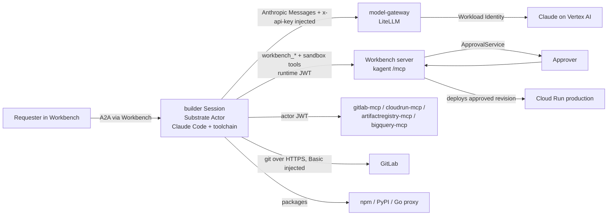

# Workbench builder agent pack

Kubernetes manifests, image, skills and model gateway for **workbench-builder**:
a Claude Code agent, run by kagent on Substrate, that builds small internal
apps for non-engineers from the [golden-path scaffolds](../scaffolds/README.md),
pushes them to GitLab, deploys previews to Cloud Run, and asks for production
through a Workbench approval.

Everything here targets the kagent `api.kagent.dev/v1alpha3` API at commit
`eb42f64`. Every field used exists in `go/api/v1alpha3/*.go`; where the PRD
wanted something kagent cannot express, this README says so (see
[Gaps](#what-kagent-cannot-express-today)).



## Files

| File | Kind | What it does |
| --- | --- | --- |
| `namespace.yaml` | Namespace `workbench-builders` | Holds everything below. kagent resolves all references, and EgressPolicy Secrets, in the referencing object's namespace, so this namespace is the credential trust boundary. |
| `harness.yaml` | Harness `workbench-claude` | `spec.claude: {}` (native Claude Code), `workload.image` = our builder image, literal `env` (git placeholder header, CA bundle for pip, registries, scaffold path), `substrate` worker pool + snapshot location. |
| `modelconfig.yaml` | ModelConfig `workbench-claude` | `provider: Anthropic`, `model: claude-opus-5-5`, `anthropic.baseUrl` = the in-cluster gateway, `apiKeySecret`/`apiKeySecretKey` = a gateway virtual key that Substrate injects as `x-api-key`. |
| `remotemcpservers.yaml` | 5 × RemoteMCPServer | `workbench-api` (Workbench's tools on kagent's `/mcp`), and the tool servers `gitlab-mcp`, `cloudrun-mcp`, `artifactregistry-mcp`, `bigquery-mcp` (Streamable HTTP, `actorJwt` auth). |
| `egresspolicies.yaml` | 2 × EgressPolicy | `workbench-gitlab` (GitLab origin with Basic credential injected from a Secret) and `workbench-packages` (npm, PyPI, Go proxy). |
| `agenttemplates.yaml` | 2 × AgentTemplate | `workbench-builder` (prompt, model, tool bindings, reviewer subagent, skills plugin) and `workbench-reviewer` (read-only review subagent). |
| `agent.yaml` | Agent `workbench-builder` | Pairs the template with the Harness; selects both EgressPolicies. |
| `sandboxtemplate.yaml` | SandboxTemplate `workbench-app-runner` | Throwaway tools environment for clean-room test runs; packages-only egress. |
| `prompts/builder.md`, `prompts/reviewer.md` | → ConfigMap `workbench-builder-prompts` | System prompts, referenced with `systemPromptFrom`. Generated by `kustomization.yaml`. |
| `kustomization.yaml` | Kustomize | `kubectl apply -k agents/` applies all of the above. |
| `image/Dockerfile` | Image | Two targets from one toolchain script: `builder` (kagent Claude harness image + toolchain + scaffolds) and `toolchain` (plain Alpine + the same, for the SandboxTemplate). |
| `image/install-toolchain.sh` | Script | git, bash, curl, jq, make, ripgrep, Node + npm, Python 3 + pip, Go, shellcheck, yamllint (all from Alpine's signed repos); uv copied from its image. No gcloud, docker, kubectl or credentials. |
| `image/Dockerfile.dockerignore` | Build context filter | Sends only the toolchain script and the scaffolds (without local `.venv`/`node_modules`). |
| `image/skills.Dockerfile` | Image | `FROM scratch` OCI artifact holding `skills/` for `spec.plugins[].source.oci`. |
| `skills/plugin.json` + `skills/skills/*/SKILL.md` | Agent Plugins package | The six skills (below). |
| `model-gateway/` | Deployment, Service, SA, NetworkPolicy, ConfigMap | LiteLLM proxy: Anthropic Messages API in, Claude on Vertex AI out, with virtual keys and budgets. `kubectl apply -k agents/model-gateway/`. |

### Skills

Packaged as one [Agent Plugins](https://agent-plugins.org) package and wired with
`AgentTemplate.spec.plugins[0]` (`source.oci` + an explicit `skills` selection).
The Claude harness copies the selected skills into a generated `kagent-skills`
plugin (`configuration-and-compilation.md`, "OCI skill delivery"). OCI was chosen
over `source.git` because OCI artifacts are mounted by Substrate before the
golden runtime starts, while Git/S3 sources are fetched at runtime under the
golden runtime's network limits.

| Skill | Used for |
| --- | --- |
| `building-internal-apps` | Talking to non-engineers: which questions, how to ask (ask-user), keeping them informed, handing over |
| `using-scaffolds` | Choosing a scaffold from `scaffold.yaml`, copying/renaming (incl. lockfile refresh), repo/branch rules |
| `deploying-previews` | MR → CI → image digest → `cloudrun_deploy_preview` → verify → `workbench_record_deployment` → DeployPreview |
| `requesting-production` | Readiness checklist, `workbench_request_promotion`, ApprovalCard, after the decision |
| `emitting-components` | `workbench_show` with exact A2UI v0.9.1 messages for Progress, DeployPreview, ApprovalCard, AppCard, CostSummary (validated against `../catalogue/catalog.json`) |
| `working-with-bigquery-data` | Schemas, dry-runs, parameterised read-only queries, maximum bytes billed, access requests |

## Apply

Prerequisites: kagent (with Substrate v1.0.0 and its egress gateway CA) installed,
a WorkerPool named `kagent-default` in `workbench-builders` (or change
`substrate.workerPoolRef` in `harness.yaml` and `sandboxtemplate.yaml`), and the
Workbench server running as the kagent control plane with its `workbench_*` MCP
extension.

1. **Let Substrate inject credentials for this namespace.** In the Substrate
   release values (credential-injection.md):
   ```yaml
   credentialProvider:
     namespacePolicies:
       - atespace: workbench-builders
         allowedNamespaces: [workbench-builders]
   ```
2. **Build and push images, then pin digests** (kagent rejects tags):
   ```sh
   docker buildx build -f agents/image/Dockerfile --target builder \
     --build-arg KAGENT_CLAUDE_IMAGE=<claude harness image of your kagent release>@sha256:... \
     -t $REG/builder-harness:$TAG --push .
   docker buildx build -f agents/image/Dockerfile --target toolchain -t $REG/builder-toolchain:$TAG --push .
   docker buildx build -f agents/image/skills.Dockerfile -t $REG/builder-skills:$TAG --push agents/skills
   ```
   Put the printed `@sha256:` digests into `harness.yaml` (`workload.image`),
   `sandboxtemplate.yaml` (`workload.image`) and `agenttemplates.yaml`
   (`plugins[0].source.oci`). The all-zero digests in the repo are placeholders.
   Replace `gitlab.example.com` (harness.yaml, egresspolicies.yaml) and the
   `workbench-platform` project/registry names with yours.
3. **Model gateway.** Create its Secret, apply, mint a key for the builders:
   ```sh
   kubectl -n workbench-system create secret generic model-gateway \
     --from-literal=master-key=sk-$(openssl rand -hex 24) \
     --from-literal=database-url=postgresql://...
   kubectl apply -k agents/model-gateway/
   # From an operator shell that can reach the service:
   curl -s http://model-gateway.workbench-system:4000/key/generate \
     -H "Authorization: Bearer $MASTER_KEY" -H 'Content-Type: application/json' \
     -d '{"key_alias":"workbench-builders","models":["claude-opus-5-5"],"max_budget":500,"budget_duration":"30d"}'
   kubectl -n workbench-builders create secret generic model-gateway-key --from-literal=api-key=<key>
   ```
4. **GitLab credential** for git over HTTPS (see `egresspolicies.yaml`):
   ```sh
   printf '%s' 'workbench-builder:glpat-...' | base64 -w0 > basic.txt
   kubectl -n workbench-builders create secret generic gitlab-git-auth --from-file=basic=basic.txt
   ```
5. **Apply the pack:** `kubectl apply -k agents/`
6. **Check:** `kubectl -n workbench-builders get agents.api.kagent.dev,sandboxtemplates.api.kagent.dev`
   and look at conditions: `Ready`, `ResolvedRefs`, `EgressPoliciesApplied`, and
   `status.warnings` on the Agent (expected: none; a partial MCP tool selection
   would show a warning here).

## Model gateway

**Choice: LiteLLM proxy** (`model-gateway/`), not a stub and not a custom service.

- The Claude harness only speaks to models through Claude Code, which supports
  the Anthropic Messages API (via `ANTHROPIC_BASE_URL`), Bedrock or Vertex. The
  kagent Claude compiler accepts `provider: Anthropic` with `anthropic.baseUrl`
  and an injected key, which is exactly a gateway that speaks Anthropic's API.
- `provider: AnthropicVertexAI` would require a Google service-account JSON key
  in a Secret, materialised inside every builder Actor - an Actor that runs
  arbitrary code. With the gateway, Vertex credentials exist only as the
  gateway pod's Workload Identity (`roles/aiplatform.user`), and the Actor only
  ever sees the placeholder `kagent-credential-injected`.
- LiteLLM already implements `/v1/messages` (and `/v1/messages/count_tokens`)
  routed to `vertex_ai/` models, virtual keys with model allowlists, budgets
  and spend tracking (Postgres), and per-key rate limits. That covers the PRD's
  per-team spend controls without writing a gateway.
- Prompt/response logging is off (`turn_off_message_logging`), because builder
  conversations contain requesters' data.

Not verified here: the proxy was not run against Vertex in this environment.
Pin a LiteLLM release you have tested with Claude Code's request shapes
(streaming, tool use, `count_tokens`), and check `VERTEX_LOCATION=global`
support in that release (use a region otherwise).

## The contract the builder assumes from the Workbench server

Served on kagent's authenticated Streamable HTTP `/mcp` endpoint (registered via
`app.Options.MCPExtensions`), reached through RemoteMCPServer `workbench-api`.
**Caller identity:** the request's `Authorization` header carries the builder
Actor's Substrate `kagent-runtime` JWT (injected by the egress gateway for the
control-plane origin). Workbench maps Actor → Session → requester/app and
authorises every call against that, never against arguments. This requires the
RemoteMCPServer URL's origin to equal kagent's configured control-plane URL.

Checked against `server/internal/mcptools/mcptools.go` as it stood when this
pack was written:

| Tool | Input | Output | Behaviour the skills rely on |
| --- | --- | --- | --- |
| `workbench_show` | `{messages: A2UIMessage[]}` - **no top-level surfaceId**; each message is `{"version":"v0.9.1", createSurface \| updateComponents \| updateDataModel \| deleteSurface}` and all name the same `surfaceId` | `{a2ui: {surfaceId, messages}}` | Validates against the catalogue (rejects with a readable error); refuses an ApprovalCard for an approval outside the conversation; stores/renders the surface. |
| `workbench_register_app` | `{name, description, scaffold, repositoryUrl?}` | `{appId, name, status, previewUrl?, productionUrl?}` | Creates the app owned by the Session's requester. |
| `workbench_record_deployment` | `{appId, environment: "preview", url, revision, image}` | `{deploymentId, appId, name, status, ...}` | Records a preview deployment; preview only. |
| `workbench_request_promotion` | `{appId, revision?, note?}` | `{status: pending\|promoted\|refused, approvalId, productionUrl?, message}` | Opens an approval routed by policy (production → approver group, never the requester) or reports one that already exists for this session (including one created by a kagent pause of this very call); Workbench deploys on approval. |
| `workbench_get_app` | `{appId}` | `{appId, name, status, previewUrl?, productionUrl?}` | Read-only, owner-checked. |

Note for the lead: the task brief described `workbench_show` as
`{surfaceId, messages}`; the server takes `{messages}` only (the Go SDK's
inferred input schema likely rejects an extra `surfaceId`). The skill and prompt
follow the server. No tool returns cost figures today, so the builder omits
CostSummary unless one is added (e.g. `cost_cents_mtd` on `workbench_get_app`).

The same endpoint also serves kagent's own tools (`create_sandbox`,
`start_sandbox_process`, `read_sandbox_outputs`, `write_sandbox_file`,
`delete_sandbox`, session/checkpoint tools), which the builder may use with
`workbench-app-runner`.

From the GCP/GitLab tool servers (built separately) the builder assumes:
Streamable HTTP MCP at `/mcp` on port 8080 in namespace `workbench-tools`;
they accept Substrate Actor JWTs with audience = their RemoteMCPServer name and
act with their own workload identity on **preview** resources only; tool names
such as `gitlab_create_merge_request`, `cloudrun_deploy_preview` (with a
`allow_create` argument, which Workbench's policy treats as new spend),
`bigquery_run_query` (plus project creation, pipeline status/job logs, image
digest lookup, service status/logs, dataset/table/schema listing and dry runs).
If they authenticate differently, change `actorJwt` to `headersFrom` with a
Secret-backed header.

## Tool approvals

`MCPToolBinding.requireApproval` **does exist** in v1alpha3
(`agenttemplate_types.go`) - `docs/architecture/human-in-the-loop.md` is stale
where it says the binding API exposes no approval policy. It pauses before each
call to a tool exposed by the binding and emits a kagent HITL
`tool_approval_request`. With the **Claude** harness:

- It is per binding, and effectively **per server**: Claude does not enforce
  `tools:` selection (the compiler warns and exposes the whole server) and a
  RemoteMCPServer may be bound only once. There is no per-tool flag, and two
  RemoteMCPServers for one URL would both expose every tool.
- Claude cannot defer parallel protected calls; extras are denied, so the prompt
  tells the builder to make gated calls one at a time.

Per-tool behaviour therefore comes from Workbench: it turns each pause into an
approval and classifies every call with its reviewed policy
(`server/internal/policy`): production deploys and IAM changes go to an
approver group; deletions and new spend may be decided by the requester;
"ordinary" calls are decided by the requester and can be remembered.

| Binding | `requireApproval` | Why |
| --- | --- | --- |
| `cloudrun-mcp` | **true** | Changes running infrastructure and spends money; Workbench's policy has rules for its tools (new service = new spend; any production deploy = approver). |
| `workbench-api` | false | Promotion already opens a Workbench approval server-side; gating would pause every `workbench_show` and sandbox call (and `delete_sandbox` would classify as data deletion). |
| `gitlab-mcp`, `artifactregistry-mcp`, `bigquery-mcp` | false | Their own credentials limit them to non-destructive / read-only work; gating would pause every pipeline poll and schema read for a non-engineer to answer. Turn on if a server gains destructive tools. |

## Egress

Deny by default is kagent's model, not something we configure: an Actor reaches
only inferred integrations (model gateway, bound MCP servers, artifact sources,
control plane) plus the EgressPolicies the Agent selects. We add exactly GitLab
(with an injected credential) and package registries. A Sandbox gets only its
template's policies (`workbench-packages`). EgressPolicy is additive only; there
is no deny rule, and only HTTP(S) origins (no SSH, so git uses HTTPS).

## What kagent cannot express today

| PRD wish | Status in kagent v1alpha3 @ eb42f64 | What we did |
| --- | --- | --- |
| Per-tool approval (e.g. only `cloudrun_deploy_preview`) | `requireApproval` is per binding; Claude harness exposes whole servers and allows one binding per server | Gate the whole `cloudrun-mcp` server; Workbench classifies per tool; production is never an agent tool |
| Restrict the builder to a subset of a server's tools | `tools:` is accepted but not enforced by the Claude harness ("Enforced selection of individual tools" is unimplemented) | Bind whole servers; tool servers must expose only preview-safe tools |
| Act as the requester on GitLab/GCP (token passthrough) | `tokenPassthrough` is rejected by the Claude compiler (Go kagent runtime only) | Tool servers see the Actor JWT; Workbench maps Actor → Session → requester |
| Secret-backed environment variables in Harness/SandboxTemplate | `env[].credentialRef` is deferred; literal values only | Credentials only via gateway header injection (ModelConfig, RemoteMCPServer, EgressPolicy) |
| Model budgets / spend limits | No such field on ModelConfig/Agent | Enforced in the LiteLLM gateway with virtual keys |
| Vertex AI with Workload Identity directly from the runtime | Claude+Vertex needs a service-account JSON key; Actor-JWT→Google exchange not supported | Gateway in front of Vertex |
| Model options (max tokens, effort) for Claude | Claude compiler rejects every `anthropic.*` option except `baseUrl` | Defaults; gateway can enforce limits |
| Subagent with its own tools/skills or model provider | Claude local agents: no tools, skills or plugins; same provider/credentials as root | Reviewer is prompt-only, same ModelConfig |
| Dedicated subagent in its own Session (`agentRef`) | Deferred | Not used |
| Non-HTTP egress (SSH git) or egress deny rules | Not exposed | HTTPS git with injected Basic auth |
| Per-agent toggle for the ask-user tool | Helm-wide only (`runtimeDefaults.builtinTools.disableAskUser`); Claude manages its own AskUserQuestion | Builder relies on it being enabled |
| Requester-facing tool-approval UX in Workbench | HITL `tool_approval_request` exists; rendering it is Workbench's job | Not used for production |

## What was validated

- All 13 `api.kagent.dev` objects (and the `kustomize build` output) validated
  against the openAPIV3Schemas in `helm/kagent-crds` at eb42f64 (unknown fields,
  types, enums, patterns). CEL rules were checked by hand, not executed.
- `kustomize build agents/` and `kustomize build agents/model-gateway/` render.
- Every A2UI payload in `emitting-components` validated against
  `catalogue/catalog.json` (component props/enums, root present, child ids exist).
- Skills package: `plugin.json` schema URL/name/fields as kagent's materialiser
  requires; each selected skill has `skills/<name>/SKILL.md` with matching
  frontmatter.
- Not done here: building the images (no Docker daemon) or running on a cluster.
