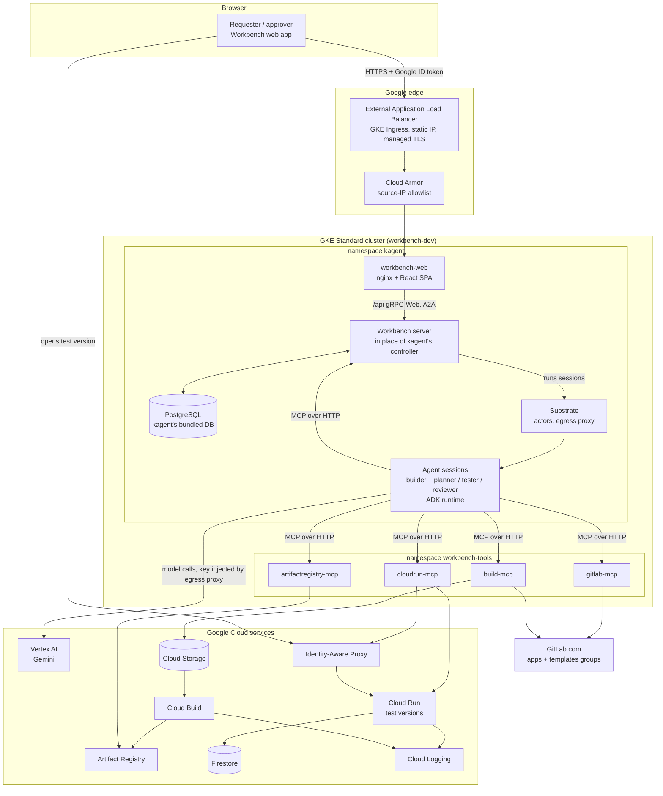
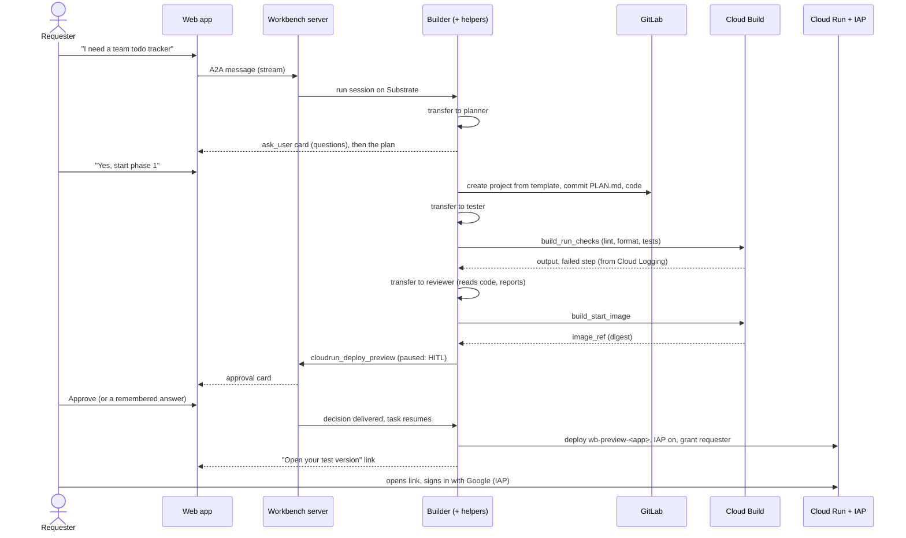

# Workbench: architecture and technology stack

This document describes everything that runs when Workbench is deployed to
Google Cloud with `deploy/gcp/up.sh`:

- every component and what it is built with;
- every Google Cloud product the deployment uses, and why;
- the identities involved and the least privilege each one holds;
- how a request moves through the system, from "I want an app" to a
  running test version.

It describes the test deployment as of 16 Nov 2026 (kagent v1.0.1,
Substrate 1.0.0). Decisions are explained in `docs/adr/`. What is built
against the PRD, and what is not, is in `docs/status.md`.

- [1. The system in one picture](#1-the-system-in-one-picture)
- [2. Components](#2-components)
- [3. Google Cloud products](#3-google-cloud-products)
- [4. Identities and permissions](#4-identities-and-permissions)
- [5. Request flows](#5-request-flows)
- [6. Deployment: phases, CI and state](#6-deployment-phases-ci-and-state)
- [7. Secrets and sensitive values](#7-secrets-and-sensitive-values)
- [8. Observability and diagnostics](#8-observability-and-diagnostics)
- [9. Cost drivers](#9-cost-drivers)
- [10. Known limits and what production would change](#10-known-limits-and-what-production-would-change)
- [11. Version reference](#11-version-reference)

---

## 1. The system in one picture



In words:

1. A person signs in to the web app with Google and asks for an app in
   plain language.
2. The **Workbench server** stores the conversation and runs an agent
   session for it. The server is a Go binary that embeds **kagent** as a
   library and replaces kagent's own controller.
3. The session runs on **Substrate**, kagent's isolated agent runtime.
4. The agent is the **builder**, which has three helpers: a planner, a
   tester and a reviewer. All four use **Gemini on Vertex AI**.
5. The agents work only through tools served over MCP:
   - Workbench's own tools;
   - GitLab (source code);
   - build (Cloud Build images and checks);
   - Cloud Run (test versions);
   - Artifact Registry (images).
6. Every tool call that changes infrastructure pauses for a human
   approval in Workbench.
7. Test versions run on **Cloud Run behind IAP**, so only people who have
   been granted access can open them. Apps that keep data use
   **Firestore**.

---

## 2. Components

### 2.1 Web app (`web/`)

The web app is the single user interface, used by requesters, approvers,
platform engineers and auditors alike. Its main screens are:

- a conversation view with streaming replies;
- approval cards and an approvals inbox;
- an activity panel;
- app catalogue, usage, schedules, sharing and settings pages.

| Concern | Technology |
| --- | --- |
| Language and framework | TypeScript, React 19, React Router 7 |
| Build and dev server | Vite |
| API clients | Connect-ES (`@connectrpc/connect-web`) speaking gRPC-Web to the server; types generated from `proto/` with `protoc-gen-es` (Buf) |
| Agent conversations | kagent's A2A (Agent2Agent) protocol, over the same transport: streaming, task resubscribe, HITL extension for approvals and `ask_user` questions |
| Sign-in | Google Identity Services ("Sign in with Google" button, ID token kept in `sessionStorage`). Also present: generic OIDC with PKCE (`oidc-client-ts`) for a company directory, and an Identity Platform path (`firebase` SDK), currently unused (ADR 0005 amendment) |
| Agent UI components | A2UI v0.9.1 renderer (`src/a2ui/`) for the reviewed component catalogue (`catalogue/`): Progress, DeployPreview, ApprovalCard, AppCard, CostSummary, Text, Button and others |
| Markdown | Own small renderer (`src/a2ui/markdown.tsx`): headings, nested lists, code, quotes, tables, links. It never parses HTML |
| Icons | lucide-react |
| Tests and lint | Vitest, Testing Library, jsdom, ESLint, TypeScript `--noEmit` |
| Mock mode | `public/config.json` `mock: true` swaps only the transport for a scripted fixture world (`src/mock/`), so mock and live share every line above the wire |
| Container | `web/Dockerfile`: static build served by **nginx**. The nginx config (`web/nginx/templates/default.conf.template`) proxies `/api/` to the server and `/__/` to the Identity Platform auth handler, and sets the security headers and CSP |

### 2.2 Workbench server (`server/`)

The server is a Go service built from kagent's code (`github.com/kagent-dev/kagent/go`,
pinned at v1.0.1). It runs in place of kagent's controller (ADR 0001),
so kagent's API, agent reconciliation, sessions and A2A endpoints are all
still there. Workbench adds its own concerns:

| Package | What it does |
| --- | --- |
| `internal/identity` | Multi-issuer JWT verification (JWKS). Trusted issuers: Google (`accounts.google.com`, audience = the web OAuth client), a company OIDC issuer, the smoke-test issuer. Maps verified emails to groups (`emailGroups`). Links Teams and mobile identities |
| `internal/authz` | Implements kagent's `CollectionAuthorizer`: roles decide which agents and conversations a person may use |
| `internal/hitl` | Reads kagent's human-in-the-loop extension: tool approval requests, `ask_user` questions, decisions |
| `internal/approval` | Approvals: classifies each paused tool call by policy, routes it (requester, approver group), applies remembered answers, delivers decisions to the paused task with retries, supersedes stale ones |
| `internal/policy` | Reviewed policy: which tools are ordinary, new spend, deletion, IAM change or production deploy, and who may decide each |
| `internal/registry` | App catalogue and promotions (preview → production) |
| `internal/audit` | Append-only audit trail (`workbench.audit_event`, where updates and deletes are revoked at database level). Includes a BigQuery exporter |
| `internal/components` | Validates and stores agents' A2UI surfaces against the catalogue |
| `internal/mcptools` | Workbench's own MCP tools for agents, e.g. `workbench_show`, `workbench_register_app`, `workbench_record_deployment`, `workbench_request_promotion`, `workbench_get_requester` |
| `internal/notify` | Notifications: in-app, email, Teams webhook, FCM (mobile push) |
| `internal/usage` | Spend limits and usage, fed by a signed usage hook |
| `internal/hooks` | Receives kagent's signed A2A push notifications (Ed25519) and usage reports |
| `internal/store` | PostgreSQL access (`pgx`), Workbench's own `workbench` schema |
| `internal/api` | Connect/gRPC services defined in `proto/workbench/v1` |

Other binaries in `server/cmd`:

- `workbench-smoke`: the end-to-end smoke test. It mints test tokens and
  covers sign-in, a HITL pause, approval routing, delivery, audit and push
  notification. It also has a `chat` mode that checks a real model.
- `workbench-mockllm`: a scripted model for deterministic tests.

The server is built with:

- Go;
- controller-runtime (it is a Kubernetes controller);
- gRPC with Connect;
- `a2a-go`;
- the MCP Go SDK;
- `lestrrat-go/jwx` for JWTs;
- `pgx` for PostgreSQL.

### 2.3 kagent and Substrate

- **kagent v1.0.1.** kagent provides the Kubernetes API for agents and
  their sessions. The `api.kagent.dev/v1alpha3` kinds Workbench uses are
  `AgentTemplate`, `Agent`, `Harness`, `ModelConfig`, `RemoteMCPServer`
  and `EgressPolicy`. It also provides sessions, the A2A server, HITL
  pauses and shared sub-agents.
  - Workbench runs kagent's Helm chart with an overlay
    (`deploy/helm/values-workbench.yaml`) that swaps the controller image
    for the Workbench server.
  - kagent's chart also brings the **PostgreSQL** database Workbench
    shares, in its own `workbench` schema (grants in
    `deploy/database/grants.sql`).
- **Substrate 1.0.0** is the sandbox runtime. Each agent session is an
  isolated *actor* with its own workspace.
  - It needs GKE **Standard**: its node agent runs privileged.
  - It also needs two beta Kubernetes certificate APIs, ClusterTrustBundle
    and PodCertificateRequest, which must be enabled when the cluster is
    created.
  - Substrate's **egress proxy** controls what an actor may reach, and
    injects credentials into outgoing requests so keys never enter the
    actor. The model's API key reaches Vertex AI this way.
- **Agent runtime:** the `kagent-default` harness runs Google's **ADK
  (Agent Development Kit) for Go**.
  - Shared sub-agents become ADK sub-agents, which hand the conversation
    to each other with `transfer_to_agent`.
  - The built-in `ask_user` tool puts clickable question cards in the
    conversation.

### 2.4 Agents (`deploy/agents/`, ADR 0006)

| Agent | Role | Tools (MCP servers) |
| --- | --- | --- |
| `workbench-builder` (lead, default agent) | Builds an app phase by phase, deploys test versions, asks for production | workbench-api, gitlab-mcp, build-mcp, artifactregistry-mcp, cloudrun-mcp. Read-only Cloud Run tools run freely; deploy, delete, IAM and share tools require approval |
| `planner` (sub-agent) | Agrees a phased plan with the requester, using `ask_user` cards | none |
| `tester` (sub-agent) | Writes tests for the current phase's checks and runs lint and tests in Cloud Build | gitlab-mcp (read, commit), build-mcp (`build_run_checks`, `build_get_status`) |
| `reviewer` (sub-agent) | Read-only code review: security, privacy, unmet checks | gitlab-mcp (read only) |

- All four agents use the `workbench-gemini` ModelConfig.
- Prompts live in the `workbench-builder-prompt` ConfigMap, made from
  `deploy/agents/*-gemini.md`.
- `agents/` holds the fuller agent pack written for kagent's Claude
  harness: skills, an image with a toolchain, and a LiteLLM model
  gateway. It is not deployed on the test cluster.

### 2.5 Tool servers (`tools/`)

Each tool server is a small Go MCP server (Streamable HTTP, MCP Go SDK)
with its own Kubernetes service account. That service account gets its
Google Cloud roles directly through Workload Identity (§4). Every server:

- logs one audit line per call;
- removes its own credentials from any error text;
- validates every argument against an allowlist.

| Server | Tools | Talks to |
| --- | --- | --- |
| `gitlab-mcp` | `gitlab_create_project` (from a template), `gitlab_get_project`, `gitlab_list_files`, `gitlab_get_file` (≤256 KiB, text), `gitlab_commit_files`, `gitlab_create_branch`, `gitlab_create_merge_request`, `gitlab_list_branches`, `gitlab_get_pipeline_status` | GitLab.com REST API with a personal access token (`api` scope). Confined to `<group>/apps`, and reads templates from `<group>/templates` |
| `build-mcp` | `build_start_image` (Docker build), `build_run_checks` (lint, format, tests: uv or npm), `build_get_status` (with the log tail and failed step) | GitLab (source archive), Cloud Storage (staging), Cloud Build, Cloud Logging |
| `cloudrun-mcp` | `cloudrun_deploy_preview` (IAP on, grants viewers), `cloudrun_get_service`, `cloudrun_list_revisions`, `cloudrun_read_logs` (with traceback tails), `cloudrun_share_preview`, `cloudrun_set_iam_invoker`, `cloudrun_delete_preview_service` | Cloud Run Admin API v2, IAP API, Cloud Logging. Only services named `wb-preview-*` and labelled as Workbench's |
| `artifactregistry-mcp` | list images, list tags, resolve digests | Artifact Registry (builds repository, read only) |
| `bigquery-mcp` | datasets, tables, schemas, dry-run and parameterised queries with a bytes-billed cap | BigQuery. Built and tested; not deployed on the test cluster |

### 2.6 App templates (`scaffolds/`)

The templates are the golden paths the builder starts every app from. They
are published to GitLab as template projects by `up.sh gitlab-setup` or
`gitlab-republish`.

| Template | Stack | For |
| --- | --- | --- |
| `python-fastapi-cloudrun` | Python 3.12, FastAPI, Jinja2 and HTMX, uv. IAP identity (JWT verified when `IAP_AUDIENCE` is set), JSON logs for Cloud Logging, `MemoryStore` or `FirestoreStore` (`google-cloud-firestore`) | Forms, lists, trackers, simple workflows |
| `streamlit-bigquery` | Python, Streamlit, BigQuery client, uv | Charts and tables over BigQuery data |
| `node-react-cloudrun` | Node 22, React and Vite client, small API server | Rich, interactive interfaces |

Every template has:

- a non-root multi-stage Dockerfile that listens on `$PORT`;
- a `/healthz` endpoint;
- tests;
- `scaffold.yaml`, a machine-readable manifest the agents read;
- `IAM.md`, the least-privilege guide.

Each template also has a GitLab CI file that runs tests and builds the
image without deploying. In this deployment builds go through build-mcp
instead.

### 2.7 Contracts

- `proto/`: Workbench's API, defined in Protocol Buffers and generated
  with Buf for Go (server) and TypeScript (web).
- `catalogue/catalog.json`: the A2UI component catalogue that agents may
  use. It is validated on the server and rendered by the web app.

---

## 3. Google Cloud products

Everything runs in one Google Cloud project, region `us-central1`. The
cluster is zonal, in `us-central1-a`.

| Product | Used for | Created by | Notes |
| --- | --- | --- | --- |
| **Google Kubernetes Engine (Standard)** | Runs the web app, the Workbench server, PostgreSQL, Substrate, the agent sessions and the tool servers | `up.sh infra` | Cluster `workbench-dev`: 3 × `e2-standard-8` nodes, rapid channel, Workload Identity pool `<project>.svc.id.goog`, beta certificate APIs for Substrate. Autopilot cannot run Substrate's privileged node agent |
| **Artifact Registry** | Docker images | `infra`, `tools` | `workbench` holds the platform images (server, web, mockllm, tool servers). `builds` holds the images of apps the builder builds, tagged by commit and deployed by digest |
| **Cloud Build** | Builds the platform images (`deploy/gcp/cloudbuild.yaml`). Through build-mcp, also builds app images and runs app checks | `images`; build-mcp at run time | App builds run as the `workbench-builds` service account, log only to Cloud Logging, and are tagged `workbench` |
| **Cloud Storage** | Deploy state; build source staging | workflow, `tools` | `<project>-workbench-state` holds the deploy state: generated secrets, exposure settings. `<project>-workbench-build-sources` holds one tarball per commit and deletes them after 7 days |
| **Cloud Run** | Test versions of apps (`wb-preview-<app>`) | cloudrun-mcp at run time | Run as `workbench-preview`; IAP on; no public invoker |
| **Identity-Aware Proxy (IAP)** | Google sign-in and per-person access in front of every test version | `tools` (service agent, OAuth settings); cloudrun-mcp (per-service access) | Uses the web app's OAuth client, because the project has no Workspace organization. IAP's service agent has `run.invoker` |
| **Vertex AI (Gemini)** | The model for all agents: `gemini-3-flash-preview` via the `global` endpoint | `up.sh model` | Reached with kagent's `Gemini` provider pointed at Vertex AI. The API key is bound to the `workbench-vertex` service account and injected by Substrate's egress proxy. Billed through Cloud Billing |
| **API Keys API** | Creates two keys: the Vertex-bound model key (secret), and the browser key for Identity Toolkit (public by design, limited to two sites and two APIs) | `model`, `expose` | Key values are masked in logs and never printed |
| **Firestore (Native mode)** | Data for test versions that must persist | `tools` | The `(default)` database in `us-central1`, shared by test versions. Each app uses collections prefixed with its name |
| **Cloud Logging** | Logs from everything | built in | Read by build-mcp (build logs), by cloudrun-mcp (app logs and tracebacks), and by the diagnostic phases |
| **Cloud Load Balancing (external Application Load Balancer)** | Public HTTPS entry to the web app | `expose` (GKE Ingress) | Global static IP `workbench-web`. Hostname `<ip>.sslip.io` until there is a real domain. One-hour backend timeout for streaming chats |
| **Google-managed SSL certificates** | TLS for the public host | `expose` (`ManagedCertificate`) | Takes 15 to 60 minutes to become active the first time |
| **Cloud Armor** | Allows only listed source IP ranges to reach the public host | `expose` | Policy `workbench-allowlist`: rule 1000 allows the ranges in `WORKBENCH_ALLOWED_RANGES`, and the default rule returns 403 |
| **Google Identity Services / OAuth 2.0** | The "Sign in with Google" button and the OAuth client that IAP uses | console (once) | One web OAuth client. Its JavaScript origin is the public host; its redirect URI is IAP's `…/clientIds/<id>:handleRedirect` |
| **Identity Platform** | Configured (authorized domains, Google provider) but not used for sign-in | `expose` | Kept for when a company directory needs it (ADR 0005 amendment) |
| **IAM, Workload Identity Federation for GKE, Service Usage, Resource Manager** | Service accounts, role grants, pod identities, enabling APIs | every phase | See §4 |
| **BigQuery** | API enabled; used by the audit exporter and bigquery-mcp | `infra` | Not used on the test cluster yet |
| **Cloud Billing** | Billing for Vertex AI, Cloud Run, Cloud Build and the rest | — | The plain Gemini API (prepaid credits) is deliberately not used |

APIs `up.sh` enables:

```
serviceusage, cloudresourcemanager, cloudbilling, container, artifactregistry,
cloudbuild, iam, run, bigquery, logging, apikeys, aiplatform, compute,
identitytoolkit, iap, firestore
```

### External services

| Service | Used for |
| --- | --- |
| **GitLab.com** | App source code. Group `thehaymaker-workbench` has two subgroups: `apps`, with one project per app, and `templates`, with the three scaffolds. A GitLab access token with the `api` scope is held by gitlab-mcp and build-mcp |
| **GitHub** | This repository and GitHub Actions: CI (`ci.yaml`) and the `deploy` workflow |
| **sslip.io** | A wildcard DNS name that maps to the static IP, so Google can issue a certificate without a domain |
| **ghcr.io and Docker Hub** | Base images for app checks: `ghcr.io/astral-sh/uv:0.11.32-python3.12-trixie-slim` and `node:22-bookworm-slim` |

---

## 4. Identities and permissions

### 4.1 People

| Who | How they sign in | What decides their role |
| --- | --- | --- |
| Requesters, approvers, platform engineers | Google account, through Google Identity Services | `emailGroups` on the Google issuer maps verified emails (`WORKBENCH_ADMINS`) to groups. Groups map to roles in `config.authorization` |
| Viewers of a test version | Google account, through IAP | `roles/iap.httpsResourceAccessor` on that one service. The requester is granted it at deploy time; anyone else only through an approved `cloudrun_share_preview` |

### 4.2 Workloads

Pod identities are bound with Workload Identity principals. Each Kubernetes
service account in `workbench-tools` gets its roles directly:

```
principal://iam.googleapis.com/projects/<number>/locations/global/workloadIdentityPools/<project>.svc.id.goog/subject/ns/workbench-tools/sa/<name>
```

No service account keys are used inside the cluster.

| Identity | Roles | Why |
| --- | --- | --- |
| `build-mcp` (pod) | `cloudbuild.builds.editor` (project); `storage.objectCreator` (staging bucket); `iam.serviceAccountUser` on `workbench-builds`; `logging.viewer` (project) | Start builds as the build service account; upload sources (create only, never overwrite); read build logs |
| `cloudrun-mcp` (pod) | `run.admin` (project); `logging.viewer` (project); `iam.serviceAccountUser` on `workbench-preview`; `artifactregistry.reader` (builds repo); `iap.admin` (project) | Deploy and manage `wb-preview-*` services; read their logs; manage IAP access on them. The code refuses any service it does not own and any public or service-account viewer |
| `artifactregistry-mcp` (pod) | `artifactregistry.reader` (builds repo) | List images and resolve digests |
| `gitlab-mcp` (pod) | none in Google Cloud | Holds the GitLab token |
| `workbench-builds@` (service account) | `logging.logWriter`; `artifactregistry.writer` (builds repo); `storage.objectViewer` (staging bucket) | Runs app builds and checks |
| `workbench-preview@` (service account) | `datastore.user` (project) | Runtime identity of every test version: Firestore and nothing else |
| `workbench-vertex@` (service account) | `aiplatform.user` | Bound to the model API key |
| IAP service agent `service-<n>@gcp-sa-iap` | `run.invoker` (project) | IAP calls Cloud Run on a viewer's behalf |
| Deployer (GitHub Actions) | The key in `GCP_SA_KEY_B64` | Runs `up.sh`. Needs rights to create and grant everything above |

### 4.3 Inside the platform

- **Agent session → Workbench tools.** The agent calls the `workbench-api`
  RemoteMCPServer, which is kagent's `/mcp` on the server. The server
  knows which session, and so which requester, made the call.
- **Agent session → tool servers.** Calls are plain HTTP inside the
  cluster. Control rests on three things:
  - the approval gate (`requireApproval` on the bindings that change
    things);
  - each server's narrow Google Cloud roles;
  - each server's own argument checks.

  The servers do not authenticate their callers yet; see §10.
- **kagent → server push notifications** are signed with an Ed25519 key
  (`workbench-push-signing`) and verified at `/hooks/a2a`.

---

## 5. Request flows

### 5.1 Sign-in

1. The browser loads the web app and Google Identity Services.
2. The person clicks "Sign in with Google". GIS returns a Google ID token,
   and the app stores it in `sessionStorage`. It renews the token silently
   before it expires.
3. Every API and A2A call carries `Authorization: Bearer <id token>`.
4. The server checks the issuer (`https://accounts.google.com`), the
   audience (the web client ID), the signature (Google's JWKS) and
   `email_verified`. It maps the email to groups, and the groups to roles.
5. Cloud Armor has already dropped any request from outside the allowed
   ranges before it reached nginx.

### 5.2 From idea to test version



### 5.3 Approvals

1. A tool binding with `requireApproval` pauses the ADK runtime, and kagent
   surfaces a HITL `tool_approval_request`.
2. The server sees the pause, through the stream, a push notification or
   a task read. It classifies each call with `policy`:
   - ordinary;
   - new spend;
   - deletion;
   - IAM change;
   - production deploy.
3. It records the approval and routes it.
   - The requester decides ordinary calls. They may "remember" the answer
     for this conversation or always.
   - An approver group must decide production deploys, and never the
     requester for their own app.
4. The server delivers the decision to the paused task (retried until it
   lands) and audits it.
5. The web app polls approvals while a turn is paused. Once the turn's
   newest approval is decided, by whatever route, it follows the task
   again.

### 5.4 A test version handling a request

1. The browser opens `https://wb-preview-<app>-….run.app`.
2. IAP checks the Google sign-in and `iap.httpsResourceAccessor`. If they
   pass, IAP calls Cloud Run as its service agent.
3. The app reads the user from IAP's headers and verifies the IAP JWT when
   `IAP_AUDIENCE` is set.
4. The app reads and writes Firestore as `workbench-preview`.

---

## 6. Deployment: phases, CI and state

`deploy/gcp/up.sh` is idempotent and runs in phases. The `deploy` GitHub
Actions workflow runs one phase per dispatch, with an optional image
`tag`. It allows one run at a time and one queued; a newer queued run
replaces an older queued one.

| Phase | Does |
| --- | --- |
| `check` | Tools, credentials, project, enables Service Usage |
| `infra` | APIs, the `workbench` registry, the GKE cluster |
| `images` | Cloud Build of all platform images, tagged with the commit |
| `kagent` | Stock kagent and Substrate through `kagent install` |
| `workbench` | Secrets, Workbench configuration, database grants, kagent's chart with the Workbench overlay |
| `smoke` | The end-to-end smoke test (eight checks) |
| `model` | Vertex service account, bound API key, `workbench-gemini` ModelConfig, one-turn check |
| `expose` / `unexpose` | Static IP, Cloud Armor, Identity Platform domains, browser key, Ingress with managed certificate |
| `gitlab-find`, `gitlab-check` | Read-only GitLab diagnostics |
| `gitlab-setup`, `gitlab-republish` | GitLab groups and template projects |
| `tools` | Builds repository, staging bucket, service accounts, grants, Firestore, IAP, tool servers |
| `builder` | Agent prompts ConfigMap, AgentTemplates and the builder Agent |
| `web-check`, `tools-check` | Read-only diagnostics (§8) |
| `status`, `down` | What is running; delete the cluster |

**CI** (`.github/workflows/ci.yaml`) runs on every push:

- the API contract check (Buf);
- server tests against PostgreSQL;
- tool server tests;
- web lint, typecheck, tests and build;
- each template's `make lint test`;
- Helm lint.

**State.** The deploy state lives in `gs://<project>-workbench-state`.
Each workflow run restores it before running and saves it after. It
holds:

- generated secrets (internal key, usage secret, push signing key, smoke
  test keys);
- the exposure settings;
- the GitLab group paths.

---

## 7. Secrets and sensitive values

| Value | Where it lives | Never |
| --- | --- | --- |
| Deployer service account key | GitHub `deploy` environment secret `GCP_SA_KEY_B64` | Written to the repo; kept on the runner after the job |
| GitLab token | GitHub secret `GITLAB_TOKEN` → Kubernetes secret `gitlab-mcp-token` (workbench-tools) | Sent to agents; printed (masked, and removed from tool errors) |
| IAP OAuth client secret | GitHub secret `IAP_OAUTH_CLIENT_SECRET` → `gcloud iap settings` from a private temp file | Logged |
| Web OAuth client ID | GitHub variable or secret `WORKBENCH_GOOGLE_CLIENT_ID` | — (public by nature) |
| Admin emails, allowed IP ranges | GitHub secrets `WORKBENCH_ADMINS`, `WORKBENCH_ALLOWED_RANGES` | In the repo or logs (diagnostics mask emails) |
| Model API key | Kubernetes secret `workbench-gemini`, injected by Substrate's egress proxy | Inside the agent sandbox; printed |
| Browser API key | Deploy state; served to browsers (public by design, limited to two sites and two APIs) | — |
| Internal key, usage secret, push signing key | Deploy state → Kubernetes secrets | In the repo |

---

## 8. Observability and diagnostics

- **Cloud Logging** receives everything:
  - container stdout from GKE;
  - Cloud Build logs;
  - Cloud Run request and app logs (JSON, with `severity` and trace
    correlation in the templates).
- **Tool audit lines.** Every tool call logs one `tool_call` line with
  tool, requester, read-only flag, outcome, duration and redacted error.
- **Workbench audit trail.** An append-only table, readable in the app.
  It records requests, decisions, deliveries, promotions and auto
  decisions.
- **`up.sh tools-check`** (read-only). It shows:
  - each tool server's failed calls;
  - cloudrun-mcp's changes;
  - each test version's IAP state and access (emails masked);
  - recent errors with the end of the traceback.
- **`up.sh web-check`** (read-only). It shows sign-in handler checks,
  nginx errors and the reasons tokens were rejected.
- **Agents see what you see.** `build_get_status` returns the build's log
  tail and failed step, and `cloudrun_read_logs` returns tracebacks, so
  the builder can diagnose failures itself.

---

## 9. Cost drivers

The biggest steady cost is the GKE cluster: three `e2-standard-8` nodes,
running all the time. `up.sh down` deletes the cluster and keeps the
images. Usage-based costs:

- Vertex AI tokens (each phase runs several agents);
- Cloud Build minutes (one image build and one or more check runs per
  phase);
- Cloud Run (scales to zero);
- Firestore operations;
- load balancer and Cloud Armor hours;
- Artifact Registry storage (app images accumulate in `builds`; add a
  cleanup policy for long-lived use);
- Cloud Logging volume.

---

## 10. Known limits and what production would change

- **Tool servers don't authenticate callers.** They trust the cluster
  network. Production should verify Substrate actor JWTs (the agent pack's
  `actorJwt` auth) and add NetworkPolicies so that only agent sessions
  reach them.
- **One shared Firestore database** for all test versions, isolated only
  by collection names. Production should give each app its own database or
  project, with IAM conditions (the templates' `IAM.md`).
- **One runtime identity** (`workbench-preview`) for all test versions.
  Per-app service accounts would follow `IAM.md`.
- **Single zonal cluster** with the bundled PostgreSQL. Production would
  use a regional cluster and Cloud SQL, with backups.
- **Production deploys.** Promotions are recorded, but the production
  deployer is `log` until a production project is configured.
- **Public entry** is an sslip.io host behind an IP allowlist. Production
  needs a real domain, possibly IAP in front of Workbench itself as an
  outer perimeter, and the company directory as the issuer.
- **Sub-agents and the web app.** Sub-agents are one level deep, and the
  web app has no agent picker, so the Concierge and Verifier agents wait
  (ADR 0006).
- **Not deployed yet:** BigQuery tools, the Teams bot, mobile apps and the
  usage reporter from the model gateway (`docs/status.md`).

---

## 11. Version reference

| Thing | Version |
| --- | --- |
| kagent | v1.0.1 (commit 558e3d7), Helm chart 1.0.1 |
| Substrate | 1.0.0 |
| ADK for Go (agent runtime) | 2.6.0 (via kagent) |
| Gemini model | `gemini-3-flash-preview` (Vertex AI, `global`) |
| GKE | rapid release channel |
| Go (server, tools) | per `go.mod`; CI uses the toolchain it names |
| Web | React 19, React Router 7, Vite, Connect-ES 2, protobuf-es 2 |
| A2UI | v0.9.1 |
| Python templates | Python 3.12, uv 0.11.32, FastAPI, google-cloud-firestore 2.x |
| Node template | Node 22 |
