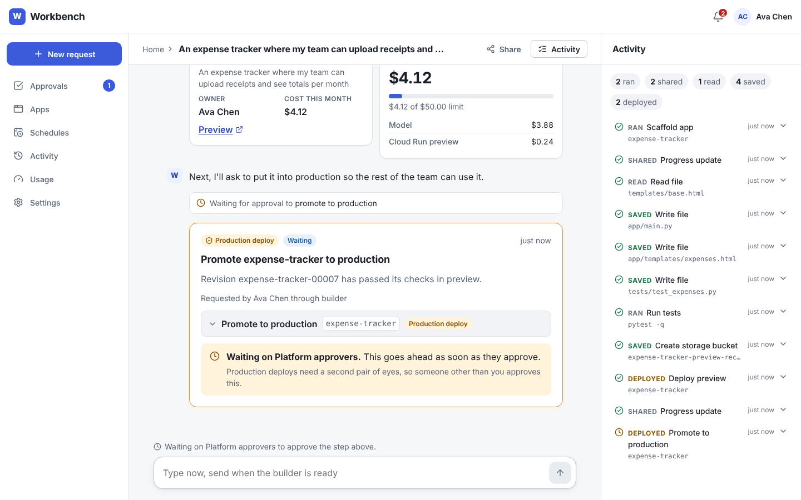

# Workbench web

The requester-facing web app for Workbench: sign in with your company account, ask for an app in plain words,
watch the builder agent work, approve the steps that matter, and get a running app.

Vite + React 19 + TypeScript (strict) + react-router 7. Server calls are gRPC-Web through
`@connectrpc/connect-web` and `@bufbuild/protobuf` v2. Styling is a small design system of our own
(`src/styles/tokens.css`, `src/styles/app.css`, `src/ui/*`): CSS variables, light and dark, no component kit.



## Run

Node 22.12+ and npm.

```sh
npm install          # .npmrc sets legacy-peer-deps (npm 10's peer resolver trips on vitest 4 + vite 8)
npm run dev          # http://localhost:5173 — public/config.json has mock: true, so no backend is needed
npm run typecheck
npm test             # vitest
npm run lint
npm run build        # dist/
npm run gen          # regenerate src/gen/workbench/v1 from ../proto (needs ~/go/bin/buf)
```

Screenshots: `npm run build && npx vite preview --port 4173 &` then
`node scripts/screenshots.cjs http://localhost:4173 docs/screenshots` (uses the machine's Playwright; drives the whole
scripted conversation at desktop and phone widths).

## Configuration

Loaded at runtime from `/config.json` before the app mounts, so one build serves every environment.
The Workbench server (or the ingress in front of it) should serve its own `/config.json`;
`public/config.json` is the development default.

| Key            | Meaning                                                                       |
| -------------- | ----------------------------------------------------------------------------- |
| `oidcIssuer`   | OIDC issuer URL. Authorization code + PKCE via `oidc-client-ts`.              |
| `oidcClientId` | Public client ID. Redirect URI is `<origin>/auth/callback`.                   |
| `apiBaseUrl`   | Root of the gRPC-Web services, normally `/api`.                               |
| `defaultAgent` | `namespace/name` of the builder agent new conversations and schedules use.    |
| `mock`         | `true` serves everything from in-process fixtures; no sign-in, no network.    |
| `oidcScope`    | Optional; defaults to `openid profile email offline_access`.                  |

The bearer token sent in `authorization` metadata is the OIDC access token (the ID token if the issuer issues no
access token). Tokens renew silently (`automaticSilentRenew`); session storage only.

## Mock mode

`mock: true` installs `src/mock/transport.ts` — a `createRouterTransport` implementing every service the app calls
(A2A, Session, Checkpoint, ScheduledRun, and all seven Workbench services) — **underneath** the app's own transport
(`setApiTransport`). Everything above the wire is the live code path: the generated clients, the interceptors, the A2A
chat client, HITL parsing, the A2UI store and renderer.

`src/mock/runtime.ts` is a tiny A2A gateway (tasks, frames, `SubscribeToTask`) and `src/mock/script.ts` the builder.
The first message in a new conversation runs the full script:

1. streamed reply, then an **`ask_user` question** (answered in chat, A2A `ask_user_response`);
2. tool calls (scaffold, read, write, tests) in the Activity panel;
3. a **Progress + DeployPreview** surface via the `workbench_show` tool result, updated by A2UI DataParts
   (`updateDataModel` percent, `updateComponents` step states);
4. an **ordinary approval** (storage bucket) the requester *can* decide, with remember-scope choices;
5. after approval the client re-attaches with `SubscribeToTask`; the preview deploys; an AppCard + CostSummary surface;
6. a **production-deploy approval** the requester *cannot* decide, shown through an ApprovalCard surface
   ("Waiting on Platform approvers … someone other than you approves this").

Later messages get a short follow-up turn. Seed data: two finished conversations (with checkpoints for
"Try again from here"), three apps, a New-spend approval from a colleague in *To decide*, audit history, notifications,
usage, limits, a schedule, a linked Teams identity and remembered answers. Mock state lives in memory: a full page
reload starts it over.

## Architecture

```
src/
  main.tsx, App.tsx          boot (config → transport → render), routes
  config.ts                  /config.json
  auth/                      oidc-client-ts (oidc.ts), AuthContext (token source, GetMe), SignIn + callback
  api/
    transport.ts             gRPC-Web transport; interceptors wrap whichever transport is in force (live or mock)
    clients.ts               one typed client per service
    useRpc.ts, errors.ts     read hook with polling; plain-language errors
    chat/                    A2A chat client (adapted from kagent), HITL extension, chat types
  a2ui/                      our A2UI v0.9.1 renderer for the Workbench catalogue
    store.ts                 surfaces by surfaceId; message-level dedupe across routes
    extract.ts               the three routes in: DataPart, workbench_show result, ListSurfaces
    pointer.ts               JSON Pointer read / immutable write (data-model bindings)
    Renderer.tsx, markdown.tsx
  approvals/                 logic.ts (what to draw from an Approval), ApprovalPanel (fetch, poll, Decide)
  conversation/              state.ts (pure timeline reducer), useConversation.ts (load, stream, follow)
  pages/                     Home, conversation/*, Approvals, Apps, AppDetail, Schedules, Audit, Usage, Settings
  layout/                    AppShell (nav, mobile drawer), NotificationsBell
  ui/                        design-system primitives (Button, Badge, Tabs, Dialog, Field, Meter, Toast…)
  mock/                      fixture world, A2A runtime, scripted agent, router transport
  gen/                       generated TS: workbench/v1 (buf), kagent/api/v1 + a2a + deps (copied from kagent)
```

Files lifted from kagent-dev/kagent `ui/` carry an Apache-2.0 NOTICE line at the top: `api/transport.ts`,
`api/chat/{a2aChatClient,hitl,a2aMetadata,types}.ts`, and the generated files under `src/gen` other than
`src/gen/workbench`.

## Where each requirement lives

| Requirement | Where |
| --- | --- |
| Sign-in, OIDC code + PKCE, runtime config | `auth/oidc.ts`, `auth/AuthContext.tsx`, `auth/SignIn.tsx`, `config.ts` |
| Home: prompt box, recent conversations, my apps | `pages/HomePage.tsx` (SessionService.CreateSession / ListSessions, AppService.ListApps) |
| Streaming chat over A2A, HITL extension activated | `api/chat/a2aChatClient.ts` (`A2A-Extensions` header on every call; `tenant` = `namespace/name`) |
| Approvals never answered with a raw `tool_approval_response` | `conversation/useConversation.ts` → `ApprovalService.ListSessionApprovals`; `approvals/ApprovalPanel.tsx` → `Decide` |
| Buttons only when `caller_may_decide`; else who it waits on; remember scope only for ORDINARY | `approvals/logic.ts`, `approvals/ApprovalPanel.tsx` |
| Poll until decided, then resume watching the agent | `ApprovalPanel` (4 s poll) → `onSettled` → `useConversation.follow` (`SubscribeToTask`) |
| `ask_user` answered in chat | `pages/conversation/QuestionCard.tsx`, `useConversation.answer` (`askUserAnswer`) |
| A2UI renderer, exactly the catalogue, bindings, fallback, no HTML injection | `a2ui/Renderer.tsx`, `a2ui/markdown.tsx`, `a2ui/pointer.ts` |
| createSurface / updateComponents / updateDataModel / deleteSurface | `a2ui/store.ts` |
| Three A2UI routes, de-duplicated by surfaceId | `a2ui/extract.ts`, `a2ui/store.ts`, `conversation/state.ts` (one timeline entry per surface) |
| ApprovalCard from live approval; AppCard from GetApp; Button → SendAction | `a2ui/Renderer.tsx` |
| Activity panel (collapsible; drawer on mobile), read/saved, args/results | `pages/conversation/ActivityPanel.tsx`, `lib/tools.ts` |
| Try again from here | `pages/conversation/tryAgain.ts` (ListCheckpoints → CreateCheckpoint if needed → ForkSession) |
| Share (create, copy, list, revoke) | `pages/conversation/ShareDialog.tsx` |
| Approvals inbox, three tabs, detail with calls/args/kind/reason | `pages/ApprovalsPage.tsx` |
| Apps registry, deployments, Request production → pending approval | `pages/AppsPage.tsx`, `pages/AppDetailPage.tsx` |
| Schedules list / create / pause / run now / delete | `pages/SchedulesPage.tsx` |
| Audit with filters | `pages/AuditPage.tsx` |
| Usage summary + limits | `pages/UsagePage.tsx` |
| Notifications bell | `layout/NotificationsBell.tsx` |
| Settings: linked identities, remembered answers, notification preferences | `pages/SettingsPage.tsx` |
| Mock mode on the same code path | `mock/*`, `main.tsx` |
| Accessibility | skip link, landmarks, labelled controls, WAI-ARIA tabs, native `<dialog>`, `aria-live` timeline, focus rings, reduced motion, AA tokens |

## Protocol assumptions the server must honour

* gRPC-Web at `<apiBaseUrl>/<package>.<Service>/<Method>`; bearer token in `authorization` metadata.
  A2A is `lf.a2a.v1.A2AService` (kagent's `a2a.proto`), with `A2A-Version: 1.0`.
* Every A2A call carries `A2A-Extensions: https://kagent.dev/extensions/hitl/v1`. A HITL pause is an
  `INPUT_REQUIRED` status whose message lists the URI in `extensions` and carries
  `metadata["https://kagent.dev/extensions/hitl/v1"] = {type: "tool_approval_request" | "ask_user_request", …}`.
* After `ApprovalService.Decide`, the server resumes the **same** A2A task. The client then follows it with
  `SubscribeToTask(tenant, id = Approval.task_id)`, which must open with a `task` snapshot and stream until the next stop.
  `Approval.task_id` must therefore be the A2A task id, and `Approval.session_id` the session/context id.
* `ListSessionApprovals(session_id)` returns the pending approval for a pause promptly (the client calls it when the
  `INPUT_REQUIRED` frame arrives). Approvals with `state = SUPERSEDED` do not resume anything.
* A2UI DataParts: `Part.data` is a JSON **array** of A2UI messages, marked by `Part.media_type` *or*
  `Part.metadata.mimeType` = `application/a2ui+json` (either is accepted).
* `workbench_show` results arrive as `function_response` DataParts (`metadata["kagent.dev/a2a/part-type"]`), data
  `{id, name, response}` where `response` is the MCP CallToolResult; `{"a2ui": {surfaceId, messages}}` is read from
  `response.structuredContent`, else `response`, `response.result`, or JSON in a text content item. The tool name is
  `workbench_show`, optionally with a server prefix (`…_workbench_show`, `…__workbench_show`).
* `ComponentService.ListSurfaces` returns each surface's full ordered message history (`Surface.messages`), and
  `Surface.task_id` is the A2A task that produced it (used to place it in the timeline).
* `ComponentService.SendAction.context` is the action's `event.context` with bindings resolved against the surface's data model.
* "Try again from here" uses `Checkpoint.head_task_id` to find the checkpoint after a turn; for the latest turn
  without one it calls `CreateCheckpoint(expected_head_task_id)` and polls `GetCheckpoint` while `CREATING`.
* Share links are `<origin>/c/<session>?share=<token>`; the token is stored per conversation in session storage and sent
  as `X-Share-Token` on A2A calls (kagent's header). The server must accept it for read access.
* `RequestPromotion` sets `App.pending_approval_id`, which the app page renders as a live ApprovalPanel.
* Notification `link` values are in-app paths (`/c/…`, `/approvals/…`, `/apps/…`).

## Gaps

* **Linking identities**: Settings lists and unlinks; linking needs an ID token from the other issuer (Teams/mobile),
  which this web app does not obtain — the copy tells people to sign in from that app.
* **Reassign** (`ApprovalService.Reassign`) and **GetPolicy** are not surfaced in the UI.
* No file attachments in the composer; no conversation rename/delete.
* Schedules are created from the Schedules page with the default agent; there is no "schedule this" from a conversation,
  and execution history (`ListScheduledRunExecutions`) is not shown.
* Usage shows the caller's own data (`mine: true`); `SetLimit` for platform engineers is not exposed.
* Audit loads one page (100 events); no "load more".
* The A2A client keeps kagent's core streaming rules but not its re-attach/resend-on-refusal retry machinery.
* Mock state resets on full reload.
